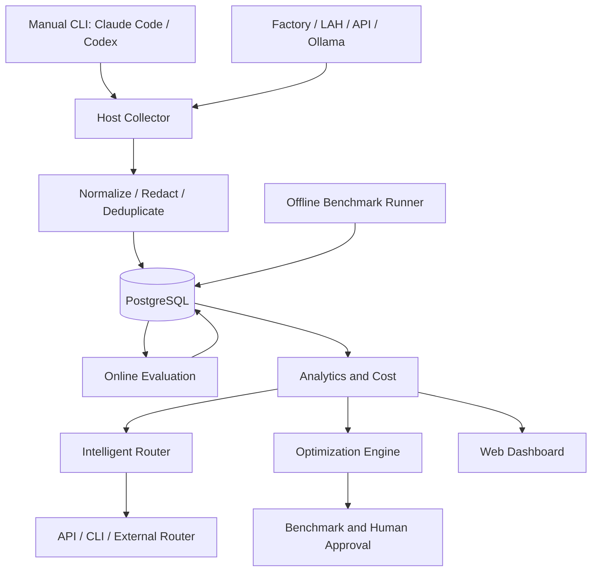

# AI Performance Hub (APH)

**Self-hosted AI observability, evaluation, benchmarking and intelligent routing.**

AI Performance Hub là dự án nền tảng độc lập giúp đo lường hiệu quả AI trên server, từ phiên Claude Code/Codex chạy thủ công đến workflow multi-agent, local model và API. Mục tiêu là lựa chọn đúng AI cho đúng công việc với chi phí thấp nhất đáp ứng chất lượng, đồng thời cải tiến Agent/Skill dựa trên bằng chứng.

> Trạng thái: **Design / Pre-implementation**. README này mô tả kiến trúc và giao diện dự kiến, không xác nhận phần mềm đã được xây dựng. Xem [PROMPT.md](PROMPT.md) để giao nhiệm vụ triển khai cho Coding Agent.

## Tính năng mục tiêu
| Module | Mô tả |
|---|---|
| Discovery & Registry | Phát hiện provider/runtime/model/agent/skill; quản lý version và account alias |
| Observability | Session, task, execution, trace, tokens, latency, retry, fallback, resource |
| Evaluation | Rule-based checks, AI judge độc lập, human feedback, hard gates |
| Benchmark | Dataset, A/B testing, regression, model/agent/skill comparison |
| Cost Analytics | Subscription, paid API, local AI, cost per accepted task |
| Intelligent Routing | Capability/security/budget/quality gates, ranking, fallback recommendation |
| Optimization | Đề xuất phiên bản agent/skill, A/B validation, approval, rollback |
| Management | Dashboard, drill-down, alerts, RBAC, audit, API/SDK/CLI |

## Kiến trúc


Collector chạy native trên từng host. Backend, database, worker và web UI có thể triển khai Docker Compose. Nếu APH gián đoạn, các phiên AI hiện tại vẫn tiếp tục; collector lưu tạm sự kiện theo giới hạn spool.

## Provider compatibility (cần POC)
| Runtime | Nguồn dữ liệu dự kiến | Giới hạn |
|---|---|---|
| Claude Code | Native telemetry, hooks, wrapper | Agent/skill/quota tùy phiên bản và cấu hình |
| Codex CLI | Native telemetry, wrapper, nguồn log hợp lệ | Event fields và quota cần kiểm chứng |
| Ollama | API instrumentation, wrapper, resource monitor | Không mặc định quan sát được mọi client |
| Other SDK/API | Adapter, SDK, OpenTelemetry | Theo capability của từng runtime |

Không có thông tin thì hiển thị UNKNOWN. APH không thu credential, không ép CLI qua proxy, không tuyên bố quan sát đầy đủ những phiên chưa được instrument.

## Công nghệ dự kiến
Python/FastAPI, PostgreSQL, SQLAlchemy/Alembic, Redis/Celery hoặc worker tương đương, React/TypeScript, Ant Design, ECharts, OpenTelemetry, Docker Compose. Promptfoo và Langfuse là tích hợp tùy chọn. Hỗ trợ Linux/macOS collector; chưa cần GPU cho APH. Tài nguyên model và benchmark tính riêng.

## Getting started
### Hiện tại: giao Coding Agent triển khai
1. Đặt `PROMPT.md` và `README.md` vào root repository mới hoặc repository APH đã có.
2. Yêu cầu Coding Agent đọc toàn bộ PROMPT.md, khảo sát server trong phạm vi được cấp quyền và bắt đầu Phase 0.
3. Kiểm tra POC report và capability matrix; duyệt thiết kế HTML trước khi agent triển khai UI production.
4. Triển khai theo phase, sử dụng test report và acceptance criteria trong PROMPT.md để nghiệm thu.

### Sau khi Phase 1 hoàn thành
Các lệnh dưới đây là **interface dự kiến**, chưa chạy được với bộ tài liệu hiện tại. Coding Agent phải cập nhật bằng lệnh thực tế đã test trước release.

Prerequisites: Git, Python và Docker Compose phù hợp với phiên bản được chốt trong ADR; quyền user để cấu hình collector; runtime AI đã cài nếu muốn giám sát. Không bắt buộc tất cả provider cùng tồn tại.

```bash
# Tại root repository, sau khi source và deployment templates đã được tạo
cp .env.example .env
# Cấu hình secret nội bộ, port, retention và host identity
docker compose up -d --build
# Sau khi CLI được cài bằng installer chính thức của dự án
aph doctor
aph discover
aph collector status
```

Cổng web/API, đường dẫn installer, version dependency và migration commands sẽ được xác định trong deployment docs. Không mở dịch vụ ra Internet trước khi cấu hình auth/TLS và firewall. Collector native có thể cài theo user service trên Linux/macOS.

## Cách sử dụng dự kiến
- Chạy `claude` hoặc `codex` như bình thường sau khi thiết lập telemetry/hook phù hợp. APH ghi nhận phiên ở mức provider hỗ trợ, không tự đổi provider.
- Vào dashboard để lọc theo provider, model, agent, skill, version, task type, project và host; xem trace và evidence.
- Gửi outcome thực tế qua UI/SDK/API. Exit code 0 không đồng nghĩa task accepted.
- Tạo benchmark dataset, chọn baseline/candidate, giới hạn ngân sách và chạy A/B test.
- Chạy routing ở shadow mode, xem quyết định và lý do; bật routing opt-in sau khi đủ dữ liệu.
- Duyệt candidate agent/skill sau benchmark, release và rollback khi cần.

## KPI và nguyên tắc đánh giá
- Quality, acceptance, first-pass, rework, evaluation coverage, cost/time/token per accepted task, reliability, quota exhaustion.
- So sánh trong cùng task type/complexity và phiên bản; báo số mẫu và uncertainty. Không đánh đồng correlation của skill trong production với tác động nhân quả.
- Điểm mặc định: `0.50 × Quality + 0.25 × Cost efficiency + 0.15 × Time efficiency + 0.10 × Reliability`, các thành phần chuẩn hóa theo baseline. Hard gate áp dụng trước ranking. Thiếu dữ liệu không tự chấm 0 hoặc 100.
- Subscription fee thực trả khác API-equivalent estimate; chi phí retry/fallback phải tính đủ. Chi phí benchmark/evaluation báo cáo riêng.

## Tích hợp
APH là control/analytics plane, không thay thế hệ thống điều phối công việc hoặc account manager.
| Công cụ | Trách nhiệm |
|---|---|
| AI Software Factory | Workflow và agent orchestration |
| LAH | Queue task/feature/defect |
| Subscription Router | Account/pool/session management hợp lệ |
| APH | Telemetry, evaluation, benchmark, routing recommendation, optimization |

API dự kiến (base `/v1`): `POST /events/batch`, `POST /tasks`, `POST /tasks/{id}/outcome`, `POST /routing/recommend`, `POST /routing/feedback`, `POST /benchmarks/run`, `GET /leaderboard`, `GET /analytics/summary`. OpenAPI chính thức sẽ được sinh và kiểm thử trong quá trình triển khai.

## Cấu trúc repository dự kiến
```text
ai-performance-hub/
├── backend/           # API, business modules, migrations, tests
├── frontend/          # Dashboard React
├── host-agent/        # Discovery, collectors, wrappers, spool
├── adapters/          # Claude, Codex, Ollama, generic
├── sdk/               # Python SDK, CLI
├── benchmarks/        # Datasets, evaluators, runners
├── config/            # Safe example configuration
├── deployment/        # Compose, native service installers
├── docs/              # PRD, HLD, LLD, ADR, API, operations, test reports
├── docker-compose.yml # Planned deployment entrypoint
├── PROMPT.md
└── README.md
```

## Security & privacy
Metadata-first; raw prompts/responses/source disabled by default. Scrub secrets before local spool and ingest. Scoped collector identities, RBAC, TLS, project isolation, audit logs, configurable retention, tested backup/restore. External judge requires explicit data policy. Benchmarks isolated from production, with time/resource/quota/budget limits. Paid API and automatic production routing disabled by default. Agent/Skill production updates require approval. Respect provider terms; do not bypass limits or authentication.

## Roadmap
| Phase | Nội dung | Trạng thái |
|---|---|---|
| 0 | Technical POC, capability matrix | Planned |
| 1 | Collector, registry, traces, dashboard, deployment | Planned |
| 2 | Evaluation, KPI, cost, analytics, alerts | Planned |
| 3 | Benchmark, A/B, regression | Planned |
| 4 | Intelligent routing, integrations, shadow rollout | Planned |
| 5 | Continuous optimization, approval, rollback | Planned |

## Known limitations / assumptions
Chưa kiểm tra trực tiếp server, source code hoặc phiên bản provider. Telemetry, quota, agent/skill attribution và manual CLI outcome còn phụ thuộc POC. Sizing, score weights và threshold là giả định khởi tạo, cần hiệu chỉnh bằng dữ liệu thực tế. Không có benchmark thực nghiệm hoặc source executable trong gói tài liệu này. License và phạm vi phân phối chưa được chủ dự án quyết định; không tự gán license OSS.
